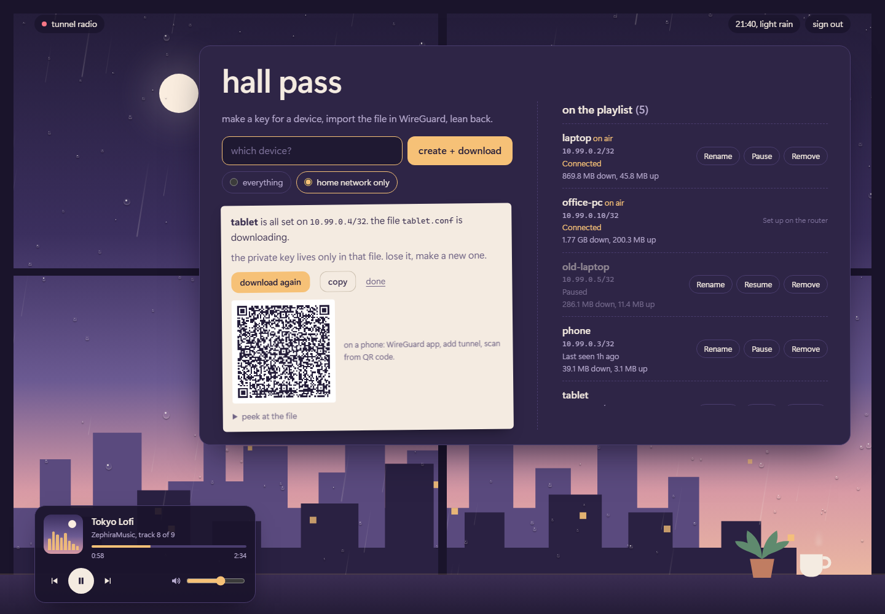
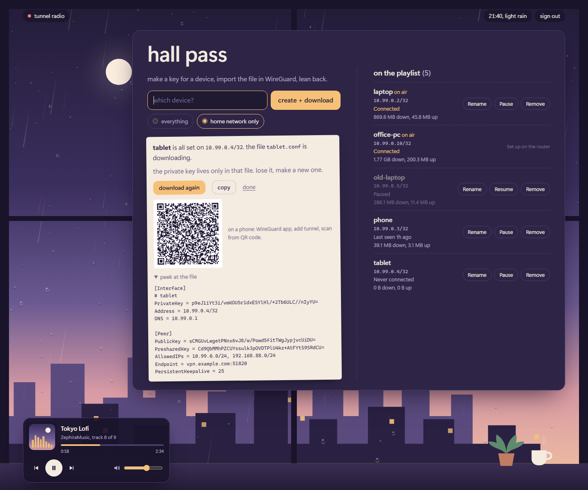
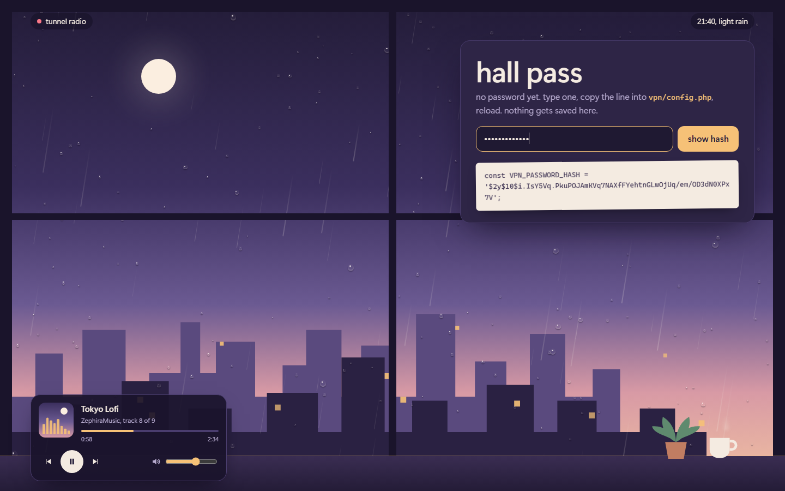
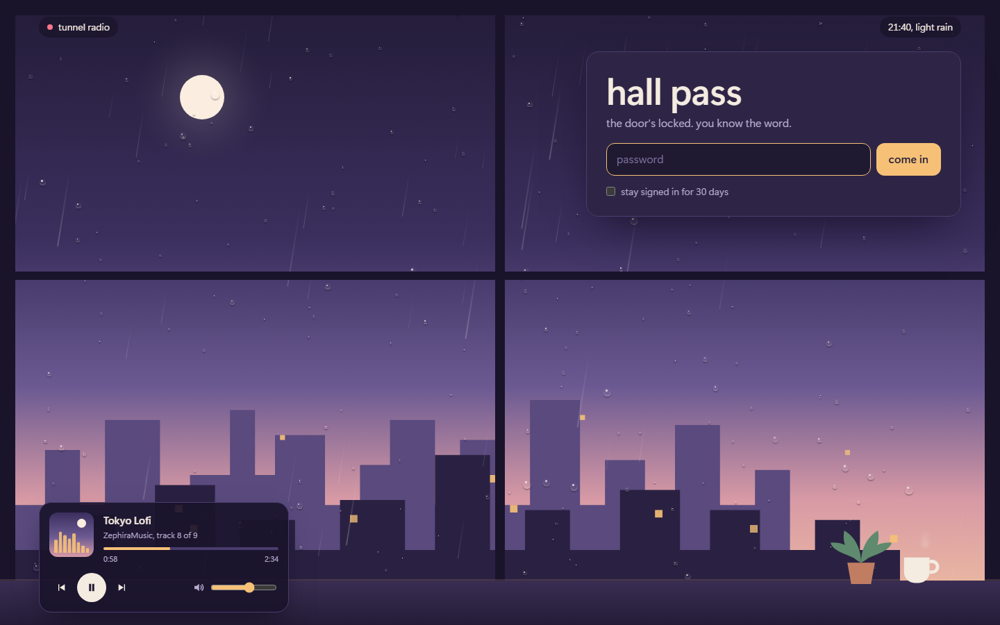
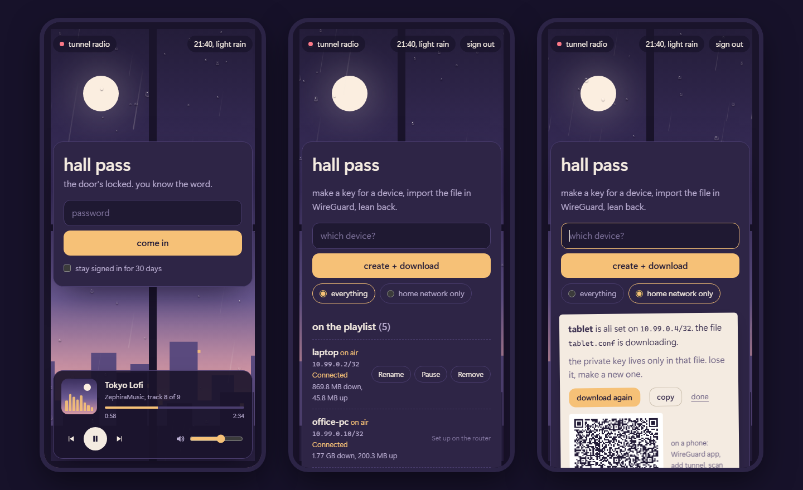

# Hall Pass

A small web page that creates WireGuard connections on a MikroTik router with one click and downloads the finished `.conf` file. It is styled as a rainy lofi-stream window with a mini music player.



| The finished `.conf` file | First start: setting the password |
|---|---|
|  |  |

| Sign-in | On a phone |
|---|---|
|  |  |

*The screenshots use demo data: the devices, addresses, keys and the hash are made up.*

- **The keys are generated in the browser.** WebCrypto X25519 makes the key pair. The private key never leaves the device; the server only receives the public key and a preshared key.
- **One click, one file.** Enter a device name and press the button. The page then:
  - picks the next free address,
  - creates the peer on the router through the RouterOS REST API,
  - downloads `name.conf`, ready for the WireGuard app or `wg-quick`,
  - shows a **QR code** for the WireGuard app on a phone, and a **copy** button for the config text.
- **Everything or home network only.** Per device you choose whether all traffic goes through the tunnel or only the home network (`VPN_ALLOWED` / `VPN_ALLOWED_HEIM`).
- **Peer list.** The page lists all peers on the interface with their online status, last handshake and traffic. Online devices come first; from 7 devices on a search field appears. The list refreshes every 10 seconds.
- **Rename, pause, remove.** Peers created by this page (comment prefix `web: `) can be renamed, paused and resumed (disabled on the router, keys stay), or removed. Peers you set up by hand stay untouched.
- **Stay signed in.** An optional 30-day sign-in; changing the password ends all of them.
- **Lofi mini player.** It plays whatever audio files are in `musik/`, with a level visualizer and volume, and resumes after a reload. Media keys, the lock screen controls and the space bar control it.

## Requirements

- PHP 8.1+ with `curl` and sessions, served over **HTTPS**. WebCrypto only works in a secure context.
- Apache-style `.htaccess` support (`mod_headers`, `mod_rewrite` optional).
- A MikroTik on RouterOS 7 with:
  - the REST API enabled (`/ip/service` `www` or `www-ssl`),
  - a WireGuard interface,
  - a user with read and write rights.
- A browser with X25519 in WebCrypto: current Chrome, Edge, Firefox or Safari.

## Setup

1. Copy the folder into your webroot, for example as `/vpn`. The paths in `index.html` and `app.js` assume `/vpn/`.
2. Copy `config.example.php` to `config.php` and set:
   - router URL, user and password,
   - WireGuard interface and network,
   - DNS and public endpoint,
   - what "home network only" routes (`VPN_ALLOWED_HEIM`),
   - reserved addresses.
3. Open the page. While `VPN_PASSWORD_HASH` is empty, the page shows a setup view: enter a password of at least 8 characters, then copy the shown hash into `config.php`.
4. Optional: put MP3/OGG/M4A files into `musik/`, named `Artist - Title.mp3`. Free lofi tracks are available on [Pixabay Music](https://pixabay.com/music/search/lofi/). The tracks are not part of this repository, because their licence does not allow redistributing the files.

If clients should also reach your home LAN, add a forward rule on the router. Place it before your drop rule, for example:

```
/ip firewall filter add chain=forward src-address=10.99.0.0/24 dst-address=192.168.88.0/24 action=accept comment="WG peers -> LAN"
```

## Files

| File | Purpose |
|---|---|
| `index.html` | The page: rainy window scene, form, peer list, mini player |
| `stil.css` | Styles (dusk palette, rain, droplets, layout) |
| `app.js` | Login, key generation, create/remove peers, `.conf` download |
| `stimmung.js` | Rain, droplets on the glass, clock, mini player |
| `api.php` | JSON API, talks to the RouterOS REST API |
| `musik.php` | Lists the audio files in `musik/` |
| `vendor/qrcode.js` | [qrcode-generator](https://github.com/kazuhikoarase/qrcode-generator) 1.4.4 (MIT), draws the QR code in the browser |
| `config.example.php` | Settings template; copy it to `config.php` |
| `.htaccess` | Strict CSP, blocks `config*.php`, no directory listing |

## Security notes

- **Login:**
  - the password is stored as a `password_hash` value,
  - a failed login waits 2 seconds; after 5 wrong passwords in 15 minutes the sender IP (`X-Real-IP`) is locked for 15 minutes,
  - "stay signed in" is a cookie signed with HMAC; its key is the password hash, so a new password ends every remembered sign-in,
  - the session cookie is `Secure`, `HttpOnly` and `SameSite=Strict`, limited to `/vpn`.
- **Request checks:**
  - every POST needs the header `X-VPN: 1`, which cross-site forms cannot set,
  - keys and names are validated before they reach the router,
  - rename, pause and remove only work on peers of this page and this interface.
- **The CSP allows only same-origin scripts, styles, connections and media.** There are no external requests; the QR code is drawn locally, so the private key never leaves the browser.
- **The peer list only returns selected fields.** RouterOS peer records also contain keys.

## Licence

Code: MIT. Music: not included; bring your own.
